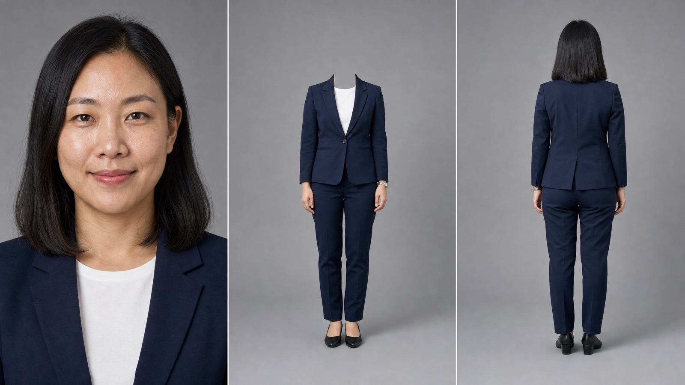
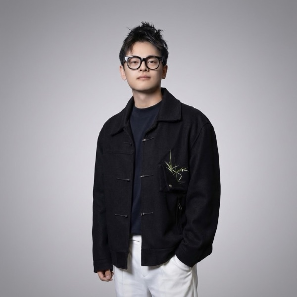
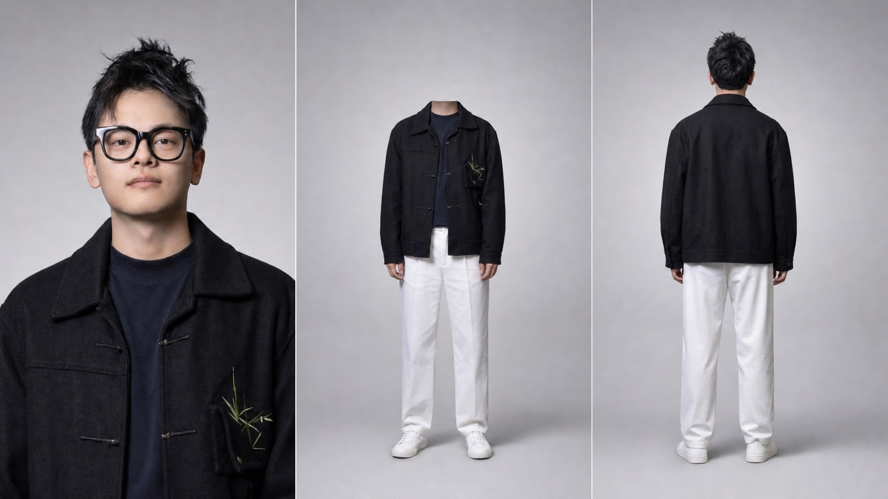

# 角色卡：先把人物定下来，再出片

AI 视频最常出事的是**人物走样**：换一个镜头就换一张脸、衣服颜色变了、背面跟正面对不上。解法是出片前先给每个人物做一张角色卡，之后每一段都拿它当参考图。

一张 16:9 横图分三格，同时锁住脸、衣服正面和背面，比分三张图省点数。

只用文字生成：



用一张半身照做（左边是输入的照片）：

 

| 格 | 拍什么 | 用来定什么 |
|---|---|---|
| 左格 | 胸部以上正面特写 | 脸、发型、眼镜这类配件 |
| 中格 | 正面全身站姿，**衣领以上整个头抹掉** | 衣服、鞋、身形（脸只从左格学，不会学到两张不一样的脸） |
| 右格 | 背面全身站姿 | 后脑的发型、衣服背面 |

## 流程

### 1. 问清楚有哪些人物（只问一轮）

- 有几个人物、各是什么身份（老板、客户、店员、妈妈……），哪个是主角。
- 每个人有没有照片：**用户本人或指定的真人一定要照片**，没有照片的就照文字生成。
- 每个人的外形：年纪、地方 + 族裔、发型、身形、整套衣服（上衣、下身、鞋、配件）、一个记忆点。用户没说的，你照身份和这条片的调性替他决定，写在交付里让他改。
- 在哪里生成：studio.aigoal.ai（GPT Image 2，可以帮他搭画布）还是别的图片工具（就只给提示词）。

### 2. 写提示词

**文字生成**（尖括号换成这个人的）：

```
一张横版真实摄影的角色设定图，纯中灰色无缝背景，柔和均匀的影棚平光，平均分成左、中、右三格，三格是同一个人、同一套衣服，格与格之间有细细的白色分隔线。人物是一位〈年纪〉的〈地方 + 族裔〉〈身份〉，〈发型〉，〈身形〉。他穿〈上衣〉，〈下身〉，〈鞋〉，〈配件〉。左格：胸部以上正面特写，〈五官的一两个记忆点〉，真实皮肤纹理，看得到细小毛孔和自然的光影明暗，肤色不均匀的地方照实留着，没有美颜、没有磨皮；表情〈中性 / 这个角色的基本神情〉，直视镜头。中格：正面全身站姿，站得笔直、双手自然下垂，衣领以上整个头部完全抹去不显示，衣领上方是空的灰色背景。右格：背面全身站姿，看得到后脑的发型和衣服的背面。画面里没有任何文字和标志。
```

**用照片做**（照片当输入，图生图）：把「人物是一位……」那句换成：

```
人物就是 @image1 这个人，脸、发型、肤色〈、眼镜〉都照 @image1 一模一样：〈年纪〉的〈地方 + 族裔〉〈性别〉，〈发型〉，〈身形〉。他穿〈照片里的衣服，写清楚颜色、款式、刺绣或图案〉，〈下身〉，〈鞋〉。
```

照片没拍到的部分（常见是裤子下半截和鞋）**一定要自己写**，不然每次生成都不一样。要换装（照片穿便服，戏里要穿制服），就只照片锁脸，衣服照戏写。

写法要点：

- **外形用正面描述**。人物身上没有的东西（眼镜、帽子、胡子）整个不提，不要写「没有戴眼镜」，提到了模型反而常会画出来。
- **当地人写清楚**：`马来西亚华人`，可以加「不是韩系偶像造型」，不然模型常给偶像脸。给一两个生活痕迹：晒过太阳的肤色、一点胡渣、几根乱翘的头发。
- **不要写** 4K、8K、masterpiece、电影级，会变塑料感。
- **只出现一两镜的小角色**（婴儿、路人）不用三格，做一张横版特写就好。
- **拟物、虚拟角色**（头是杯子、动物、吉祥物）：一样三格，把「人物是一位……」换成那个造型的具体描述（材质、颜色、图案、哪一边有什么），左格写清楚五官长在哪里、怎么过渡到材质。造型不对称的（杯柄、单边角），写明正面看在画面哪一边、背面看在哪一边。
- 同一部片的人物，背景、光、三格的写法要一字不差，只换人物那几句，整组卡才会像同一套。

### 3. 交付

存成 `<输出文件夹>/角色卡.md`，同时把每张的提示词贴在对话里方便复制：

````markdown
# 角色卡：<项目名>

16:9 横版三格角色卡，GPT Image 2 生成。选定后当 Seedance 每一段的参考图。

## 四、素材清单

| 图 | 是什么 | 有了吗 | 用在 |
|---|---|---|---|
| 图P | 主角本人照片 | ✅ `素材/主角.jpg` | 图A 的输入 |
| 图A | 主角 · 角色卡（横） | ⬜ | 全片 |
| 图B | 客户 · 角色卡（横） | ⬜ | 第 2、3 段 |

- **图A**（输入：图P）：「一张横版真实摄影的角色设定图……人物就是 @image1 这个人……」
- **图B**：「一张横版真实摄影的角色设定图……」

## 外形一句话（之后写影片提示词时每段照抄）

- 图A 主角：〈年纪、族裔、发型、整套衣服，一句写完〉
- 图B 客户：……

## 待填

- 列出你替用户决定、要他确认的外形
````

标题「## 四、素材清单」和「图X / 有了吗 / 档案用反引号」的格式不要改，搭画布的脚本会读。名字带「角色卡」就出 16:9。

### 4. 搭进 studio.aigoal.ai（用户在 studio 生成时）

用 video-reverse 的画布脚本（装 aigoal-skills 就有）：

```bash
python3 "<skills 文件夹>/video-reverse/scripts/build_studio_canvas.py" "<输出文件夹>/角色卡.md"            # 先看会搭出什么
python3 "<skills 文件夹>/video-reverse/scripts/build_studio_canvas.py" "<输出文件夹>/角色卡.md" --build    # 上传照片、建画布
```

- 要用户的 studio 钥匙：请用户自己设环境变量 `AIGOAL_STUDIO_KEY`，或在输出文件夹建 `.env` 写一行 `AIGOAL_STUDIO_KEY=…`。**不要让用户把钥匙贴进对话。**
- **只搭画布，不按 Run**，Run 会花用户的点数（一张约 1 credit）。告诉用户**先只跑主角那一张**，满意了再跑其他人。
- 不满意要改：改 `.md` 里那句描述，加 `--update` 重搭同一张画布，跑过的图会保留。

### 5. 出图后检查

用户跑出来后，打开图看：

- 左格的脸像不像照片本人；眼镜、发型、痣这类记忆点有没有照到。
- 三格是不是同一套衣服、同一个颜色；背面有没有多出正面没有的东西。
- 中格的头有没有抹掉。偶尔会留一点下巴和脖子，不影响用。
- 画面里有没有字、logo。

## 之后接 Seedance 时

每段提示词接角色卡时都加这一句，不然会把格子、灰底拍进影片：

```
@image1 是角色设定图，三格是同一个人（左格定脸，中格定衣服，右格定背面），只参考人物，不要画出格子、分隔线和灰底。
```

再接「外形一句话」，每段一字不差。要照爆款写分段提示词，用 video-reverse。

## 分寸

- 用户本人或指定真人的照片，只用来做他自己的角色卡；不要拿名人、网红或别人的照片做，被拒绝或被审核拦下也是这个原因。
- 用户说「直接跑」才帮他按 Run，并先说一张大约多少点数。
